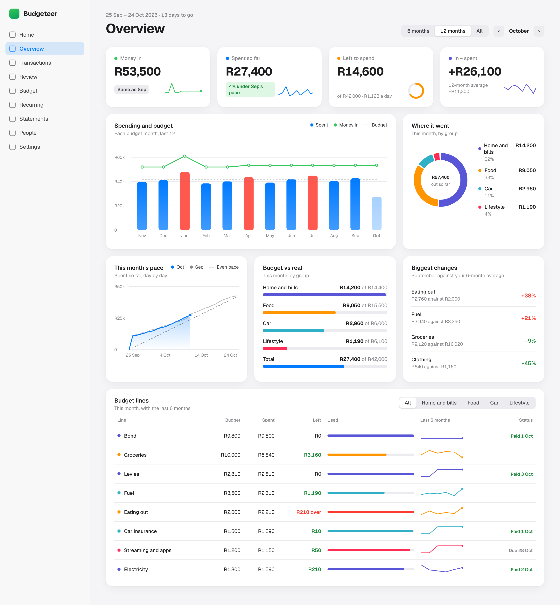

# Desktop overview: plan

A high-level summary for the Mac: how this budget month is going and how the months compare, on one calm
screen in the style of Apple's own apps. It is for sitting down once a week or at month end, not for doing
the bookkeeping, which stays on the existing screens. The phone screens do not change.

This is a plan, not built yet. The mockup shows the look with made-up numbers and made-up groups:
[`docs/mockups/desktop-overview.html`](mockups/desktop-overview.html), with screenshots in
[light](mockups/overview-light.png) and [dark](mockups/overview-dark.png).

## Decided

| Question | Decision |
|---|---|
| Own screen or Home on a wide screen | **Own screen**, Overview; Home stays the start page |
| Groups | **The household's own groups**, named and filled from its own budget lines; no fixed list |
| Savings | **Left out**: no Saved tile, no savings group, transfers stay out of everything |
| Line chart | **Spending against the even pace** of the budget, not account balances |
| Budget line in the monthly bars | Today's budget for every month (the app keeps no old budgets) |
| Font | Geist, as on every other screen |

---

## 1. What the screen answers

| Panel | Question it answers | Built from |
|---|---|---|
| Four tiles: **Money in**, **Spent so far**, **Left to spend**, **In − spent** | Where do we stand this month? Each with a small trend or a comparison with last month | This month's totals; the same day last month; the last 12 months |
| **Spending and budget** (bars per month, a money-in line, the budget dashed) | Are we living within the budget and within what comes in, month after month? | One total per budget month |
| **Where it went** (donut by group) | What does the money go to? | This month by group |
| **This month's pace** (running total, last month in grey, the even pace dashed) | Are we spending faster than the budget allows? | Spent per day, this month and last |
| **Budget vs real** (a bar per group and the total) | Which kind of spending is using the budget? | This month by group |
| **Biggest changes** | What has changed lately? | Last full month per line against its average over the 6 months before |
| **Budget lines** (table, filtered by group) | How is each line doing, and is it usually like this? | This month per line, a 6-month sparkline, the recurring payment's status |

The range control (6 months, 12 months, All) sets how far back the bars and sparklines reach; the arrows step
through budget months, like the period switcher on Home. Clicking a bar, a group, a line or a change opens
Transactions filtered to it.

## 2. Where it lives

A new screen, **Overview** (`GET /overview`, `OverviewController`), second in the sidebar after Home. Like
Recurring and Statements it is in the sidebar only, so no phone tab links to it; under 64rem it still works,
stacked in one column. It takes Home's `?in=` date, plus `range=6|12|all`.

The page is wider than the others (about 88rem against 72rem) on a 12-column grid: tiles of 3 columns, then
8 + 4, then 4 + 4 + 4, then the table across all 12. That fits a 13-inch MacBook (1440 by 900 points) with the
tiles and the first charts above the fold, and stays balanced up to a 27-inch screen.

## 3. The look

Apple's apps (Health, Stocks, Screen Time, System Settings) are the model:

- **Surfaces:** a light grey page (`#f5f5f7`), white cards with an 18px radius and a very soft shadow, no
  borders; in dark mode a black page and `#1c1c1e` cards without shadow, following the Mac's appearance
  setting as the app already does.
- **Colour:** Apple's system colours, used sparingly and always with a word or number beside them: blue for
  spending, green for money in, orange for what is left, red only for over budget. Each group has its own
  colour (4.1) and keeps it everywhere: donut, bars, table dots, sparklines.
- **Type:** Geist; one large bold title, big figures in the tiles, small grey labels, tabular figures so
  amounts line up.
- **Controls:** a segmented control for the range and the table filter, small rounded arrows for the month.
- **Charts:** rounded bar tops, a soft gradient under the running total, hairline grids, a dot on the latest
  value, no chart borders or 3D.
- **Calm:** white space instead of lines, few colours per chart, and red only where something is really over
  (a month more than 3% over its budget, a line over its amount).

The new colours and the card style are tokens in `public/css/app.css` with light and dark values, scoped to
`.overview` so the phone screens look exactly as now. The sidebar gets a light touch to match (the selected
item in a soft blue pill), which phones never see.

## 4. Changes to the data

### 4.1 The household's own groups

Groups are made by the household from its own budget lines, so they fit however the budget is already
thought of ("Huis", "Kos", "Kar", "Kinders", or anything else).

- New table `category_groups`: `household_id`, `name` (unique per household), `colour`, `sort`.
- New column `categories.category_group_id`, nullable, set to null when its group is removed.
- **Colour:** handed out in turn from a palette of Apple system colours (indigo, orange, teal, pink, purple,
  yellow, mint, brown), the way people and projects get theirs (`HasOwnerColour`), and changeable.
- **Budget screen, new Groups section:** add, rename, reorder and remove groups. Each budget line gets a group
  select beside its amount, saved with the existing **Save**.
- **Pasted budgets:** a line with no amount ("Huis", "Kar") starts a group, and the lines under it go into
  it, so a spreadsheet laid out in sections pastes in one go.
- **Lines without a group** count under "Other" in the group panels. With no groups at all, the donut and
  Budget vs real show the five biggest lines and "Everything else" instead, so the Overview is useful from the
  first day.

### 4.2 Nothing else

No other new data: money in, spending, budgets, days and recurring payments are all there already.

## 5. The numbers

Two services, so Home and Overview can never disagree:

- **`App\Services\MonthSummary`** takes over the sums `HomeController` does today (money in, spent, each line,
  with the same rules: transfers between own accounts, purchases charged to people and special projects left
  out; uncategorised spending as its own line) and adds the groups and spent per day. Home then reads from it;
  the existing Home tests (`NavigationTest`, `OwedTest`, `ProjectTest`, `RecurringTest`) must pass unchanged.
- **`App\Services\Trends`** gives the months in the range: per budget month money in, spent and spent per
  line. One query over the whole range, grouped by day and category, sorted into budget months in PHP with
  `BudgetPeriod`, since months start on the household's own day. A few years of transactions is a few thousand
  rows, so no caching at first.

| Number | Rule |
|---|---|
| Spent so far against last month | Spent up to the same day of last month's period ("4% under Sep's pace") |
| Left to spend a day | Left to spend ÷ days to go, for the current month only |
| In − spent | Money in minus spent, as on Home; the sparkline shows it per month |
| Even pace | A straight line from nothing on the first day to the whole budget on the last |
| Budget in the monthly bars | Today's budget for every month; a month more than 3% over it is red |
| Months shown | From the first month with transactions (or the household's keep-from date); empty months are not drawn |
| Biggest changes | The last full month per line against the average of the 6 before it; lines with at least R300 a month and a change of at least R200; the two biggest rises and the two biggest falls |
| Status in the table | From `RecurringSchedule::occurrences()`: paid with its date, due with its date, late or changed |

## 6. Drawing the charts

No chart library. The site's security policy allows only its own scripts and no inline styles, there is no
JavaScript build step, and the bars, rings and circles the app already has are SVG drawn on the server. The
charts follow suit: Blade components work out the geometry in PHP and give every shape a class, so colours
come from the stylesheet and switch with dark mode. Group colours are classes too (`.group-indigo` …), one per
palette colour. Gradients are SVG `<linearGradient>` definitions, which the policy allows.

| Component | Draws |
|---|---|
| `x-chart.columns` | Monthly bars with a line and a dashed reference line (Spending and budget) |
| `x-chart.area` | Running totals with a gradient fill and the even pace (This month's pace) |
| `x-chart.donut` | Shares as arcs (`stroke-dasharray`) with the total in the middle |
| `x-chart.spark` | Sparklines in the tiles and the table |
| `x-ring`, `x-bar` | Exist already; reused for Left to spend and Budget vs real |

- The geometry (scales, round tick values like R20k, arcs) lives in `App\Support\Charts` and is unit-tested
  without rendering.
- **Hover:** every bar, point and slice has an SVG `<title>`, so the Mac shows its value as a tooltip with no
  JavaScript. A later step can add a small `public/js/overview.js` for an Apple-style hover readout (a
  vertical line with the month's numbers), still allowed by the policy.
- **Accessible:** each chart has `role="img"` and an `aria-label` that says its numbers; the table holds the
  per-line numbers; colour is never the only signal; a `forced-colors` block as for the bars.

## 7. Steps

Each step is a branch merged into `main` with `composer check` green, and leaves the app working.

| # | Step | Visible change | Tests |
|---|---|---|---|
| 1 | `MonthSummary`; Home reads from it (done) | None | Sums and exclusions; Home tests unchanged |
| 2 | Groups: table and column, Groups section and select on Budget, sections in pasted budgets | Groups on Budget | Adding, renaming, removing (lines become ungrouped), colours in turn, pasting with sections |
| 3 | Overview screen with the look: tiles, Budget vs real, Budget lines table (no sparklines yet); sidebar item | New screen | Each panel's numbers; excluded transactions; no groups yet; empty household |
| 4 | `Trends` and the charts: Spending and budget, Where it went, This month's pace, sparklines; range control | Charts | `Charts` geometry; `Trends` bucketing with a start day of 25; chart labels carry the numbers |
| 5 | Biggest changes; clicks through to Transactions, which learns a `group` filter | Panel, links | Thresholds and ordering; each link's filter |
| 6 | Polish: hover readout, check at 1280, 1440 and 1920 wide in Safari, light and dark | Hover readout | Browser screenshots at those widths |

Steps 1 to 4 give the screen most of its value.

## 8. Not planned

- Savings (decided above).
- Editing amounts on the Overview; that stays on the Budget screen, one click away from each line.
- A transaction filter on the Overview; Transactions already filters.
- A chart library or a JavaScript build step.
